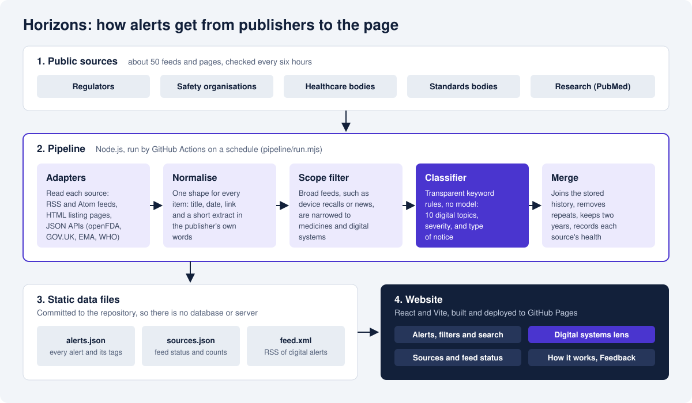

# Horizons

**Live site: https://snbyrnes.github.io/Horizons/**

Medication safety alerts from regulators, safety organisations, healthcare bodies and standards bodies worldwide, with a lens on **medication safety in digital systems** (ePrescribing, health records, decision support, infusion pumps, dispensing automation, barcoding, interoperability, software and AI).

Horizons is a static site. A scheduled GitHub Actions job gathers the alerts, commits the refreshed data, and redeploys GitHub Pages. There is no server and no API key.

## How it works



```
GitHub Actions (every 6 hours)
  └─ npm run fetch        pipeline/run.mjs reads every source in pipeline/sources/
       ├─ adapters.mjs    RSS/Atom, HTML listings, GOV.UK, openFDA, Health Canada, PubMed, ...
       ├─ classify.mjs    keyword rules: digital topics, severity, type of notice
       └─ writes          public/data/alerts.json, public/data/sources.json, public/feed.xml
  └─ git commit           the data files (history is kept for two years)
  └─ npm run build        Vite + React + TypeScript
  └─ deploy               GitHub Pages
```

- A source that fails keeps its previous alerts and is shown as "Not reachable" on the Sources page. If most sources fail at once the run leaves the existing data untouched.
- Text is the publisher's own title and extract. Nothing is rewritten by a model.
- Severity and digital topics are assigned by transparent keyword rules in [pipeline/classify.mjs](pipeline/classify.mjs), explained in the app under "How it works".

## Run it locally

```bash
npm install
npm run fetch     # gather alerts (takes about a minute)
npm run dev       # open the site
npm test          # pipeline tests
npm run build     # production build in dist/
```

Useful while working on sources: `node pipeline/run.mjs --dry --only mhra,tga` fetches just those sources and prints counts without writing files.

## Add a source

Add an entry to the right file in [pipeline/sources/](pipeline/sources/):

```js
{
  id: 'example',                 // stable, unique
  name: 'Example Medicines Agency',
  short: 'EMA-X',                // shown in the alert list
  country: 'Exampleland',
  region: 'Europe',              // Global | UK and Ireland | Europe | North America | Asia-Pacific | Rest of world
  type: 'regulator',             // regulator | safety | healthcare | standards | research
  home: 'https://example.org/',
  lang: 'en',
  filter: 'medication',          // all | medication | medication-digital | digital
  feeds: [{ url: 'https://example.org/alerts.rss' }],
}
```

For a page with no feed, use the `html` adapter with CSS selectors:

```js
feeds: [{ adapter: 'html', url: '...', select: { item: 'li.alert', title: 'h3 a', date: 'time', summary: 'p' } }]
```

Check it with `node pipeline/run.mjs --dry --only example` before committing.

## Sources we could not include

We tried these and could not read them automatically. **If you work with one of these organisations, or know of a public feed, API or contact we missed, please [open an issue](https://github.com/snbyrnes/Horizons/issues/new?template=suggest-a-source.yml).** The same list is on the site's [Sources page](https://snbyrnes.github.io/Horizons/#/sources).

| Organisation | Country | What happened when we checked |
| --- | --- | --- |
| ISMP (US) newsletters and alerts | United States | Member content sits behind a login. Public articles are covered through the ECRI and ISMP feed. |
| ECRI alerts and Top 10 Health Technology Hazards | United States | No public feed or listing page. |
| Joint Commission Sentinel Event Alerts | United States | The list is drawn in the browser by a search widget, so there is nothing to read from the page itself, and there is no feed. |
| AHRQ Patient Safety Network (PSNet) | United States | The feed responds but has not been updated since March 2025. |
| United States Pharmacopeia (USP) | United States | Refuses automated readers (access denied). |
| ASHP drug shortages | United States | The RSS feed has been discontinued. |
| CDC Health Alert Network | United States | The feed responds but is empty. |
| Drug Shortages Canada | Canada | Bot challenge on the feed, and the API needs a registered account. |
| NHS Specialist Pharmacy Service | United Kingdom | Bot challenge on every page and feed we tried. |
| NHS England Digital: clinical safety (DCB0129 and DCB0160) | United Kingdom | Bot challenge on news and clinical safety pages. |
| Patient Safety Learning hub | United Kingdom | Bot challenge on the site and its feeds. |
| NHS Wales patient safety alerts and notices | United Kingdom | We could not find a dated list of alerts or a feed. |
| NHS Scotland incidents and alerts (NSS IRIC) | United Kingdom | No dated list or feed; the page points to other sites. |
| CBG-MEB (Medicines Evaluation Board) | Netherlands | News is drawn in the browser and there is no feed. Lareb covers the Netherlands for now. |
| Norwegian Medical Products Agency (DMP) | Norway | News is drawn in the browser and there is no feed. |
| ISMP Spain | Spain | Rate-limited our first request. |
| Australian Commission on Safety and Quality in Health Care | Australia | The site did not answer automated requests when we checked. |
| Australian Digital Health Agency | Australia | The site did not answer automated requests when we checked. |
| Safer Care Victoria safety alerts | Australia | The site did not answer automated requests when we checked. |
| SA Health medication safety alerts and notices | Australia | Refuses automated readers (access denied). |
| CDSCO and the Pharmacovigilance Programme of India | India | Connections timed out or returned server errors. |
| ANVISA health alerts | Brazil | The alerts service refuses automated readers and the public page is drawn in the browser. |
| International Medical Device Regulators Forum (IMDRF) | International | The site did not answer automated requests when we checked. |
| International Medication Safety Network | International | Reachable, but nothing new has been posted since 2023. |

## Feedback and contributions

Horizons gets better when the people who use it say what is missing. The site has a [Feedback page](https://snbyrnes.github.io/Horizons/#/feedback), and everything goes through [GitHub issues](https://github.com/snbyrnes/Horizons/issues):

- [Suggest a source](https://github.com/snbyrnes/Horizons/issues/new?template=suggest-a-source.yml), especially one that covers digital systems
- [Report a wrong label](https://github.com/snbyrnes/Horizons/issues/new?template=wrong-label.yml) on an alert
- [Share an idea or a problem](https://github.com/snbyrnes/Horizons/issues/new?template=feedback.yml)

Pull requests that add a source are welcome.

## Deploy on GitHub Pages

1. Push this repository to GitHub.
2. In **Settings > Pages**, set **Source** to **GitHub Actions**.
3. Run the **Update alerts and deploy** workflow once from the Actions tab. After that it runs every six hours and on every push to `main`.

The build uses relative paths, so it works at `https://<user>.github.io/<repo>/` without configuration.

## Search visibility

The app is rendered in the browser, which search engines read poorly, so the build also writes plain HTML with [scripts/prerender.mjs](scripts/prerender.mjs):

- a snapshot of the latest alerts inside `index.html` (the app replaces it on load)
- one page per digital topic (`/topics/infusion-pumps/` and nine others) and per region (`/regions/europe/` and five others), refreshed every six hours
- `sitemap.xml`, canonical links, Open Graph tags, a social preview image and schema.org `WebSite` and `Dataset` data

Three things need the site owner:

1. **Google Search Console and Bing Webmaster Tools**: verify the site and submit `https://snbyrnes.github.io/Horizons/sitemap.xml`. Nothing is indexed quickly without this.
2. **A custom domain** (optional but recommended): a project page under `github.io` cannot serve a `robots.txt` at the host root and ranks less well than its own domain. If you add one, set `SITE_URL` in the workflow.
3. **Links from other sites**: ranking depends mostly on reputable sites linking here, for example professional bodies, medication safety networks and hospital pharmacy pages.

## Important

Horizons is a scanning aid. It links to original notices and does not replace them, and it is not a substitute for formal alerting channels such as a national central alerting system. Classification is automated and will sometimes be wrong.
